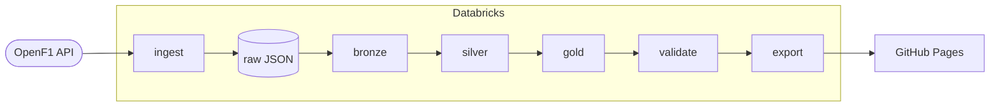

# f1-lakehouse

Formula 1 data pipeline on Databricks. Pulls session data from the [OpenF1 API](https://openf1.org), builds bronze/silver/gold tables, and publishes race and qualifying results for every weekend, plus the championship standings after each round, to a static site once a week.

Live site: https://petterr-n.github.io/f1-lakehouse/

## How it works



A job runs every Monday after race weekends: ingest new sessions, run the pipeline, validate, export. If validation fails the export is skipped, so the site just keeps last week's data.

Bronze, silver and gold are one Lakeflow pipeline (SQL in `pipeline/`). Ingest, validate and export are notebooks.

## Tables

- bronze: raw API responses, one table per endpoint
- silver: cleaned and deduplicated sessions, results, drivers, laps, stints, pit stops, weather etc.
- gold: star schema (`dim_driver`, `dim_session`, `fact_session_result`, `fact_lap`) plus standings, tyre degradation and the tables the site uses

`dim_driver` is SCD type 2, so points go to the team the driver was actually with at each race.

## Data quality

The pipeline has expectations on most silver/gold tables. Some fail the run, some drop the row, some just count violations.

`notebooks/validate.py` does the checks that need more than one row: one winner per race, unique driver keys, no overlapping stints, no rows lost between layers, and 2025 final standings matching the official ones.

## Things worth knowing about the OpenF1 data

- Cancelled races show up as normal sessions, just with no results
- Starting grids are attached to the qualifying session, not the race
- Car numbers aren't stable (reused and changed between seasons), so drivers are keyed on name
- Session keys aren't in date order
- Lapped cars have `"+1 LAP"` as text in the gap field
- A few races have stints that overlap by one lap
- Missing track temperatures come through as 0 °C

Sessions are only ingested 12 hours after they end, otherwise you can get partial data.

## Layout

```
databricks.yml        bundle config (dev + prod)
resources/            job and pipeline definitions
pipeline/             bronze/silver/gold SQL
notebooks/            ingest, validate, export
src/f1_ingest/        ingest logic (unit tested)
tests/
web/                  static site (Vite + TypeScript)
.github/workflows/
```

## Running it

```bash
pytest
databricks bundle deploy -t dev
databricks bundle run f1_weekly -t dev
```

Site, locally (copy `races.json`, `qualifying.json` and `standings.json` from the export volume into `web/public/data/` first):

```bash
cd web && npm install && npm run dev
```

CI runs the tests and validates the bundle on PRs. Merging to `main` deploys to prod. The site is republished every Monday and whenever `web/` changes. Workflows need `DATABRICKS_HOST` and `DATABRICKS_TOKEN` set as repo secrets.

## Notes

OpenF1 only has data from 2023 onwards. Tyre degradation numbers are a bit low since fuel burn makes cars faster over a stint, which hides some of the wear.

Data: [OpenF1](https://openf1.org). Not affiliated with Formula 1.